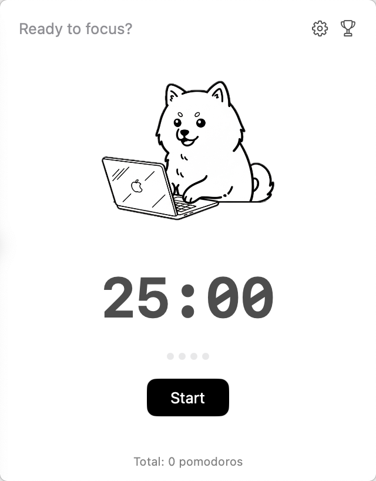
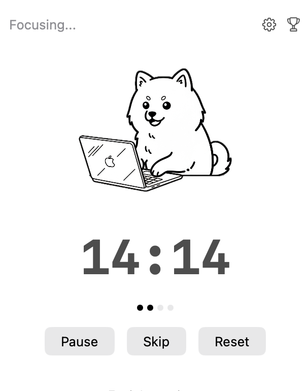
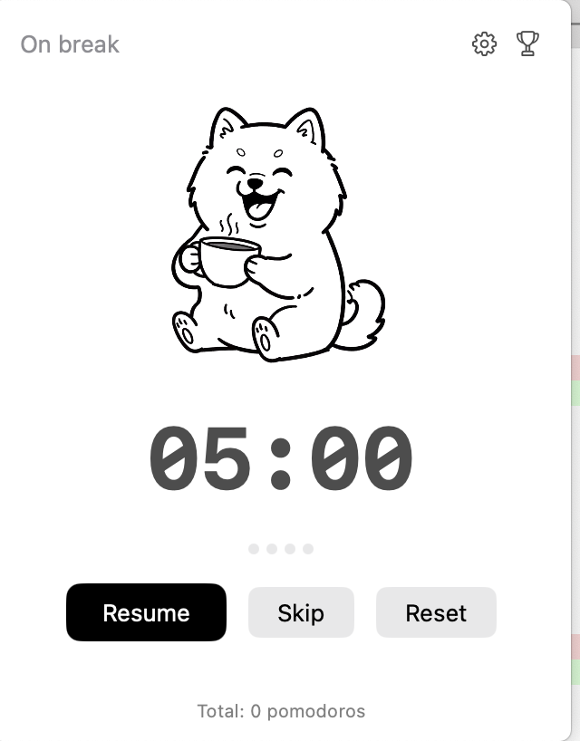
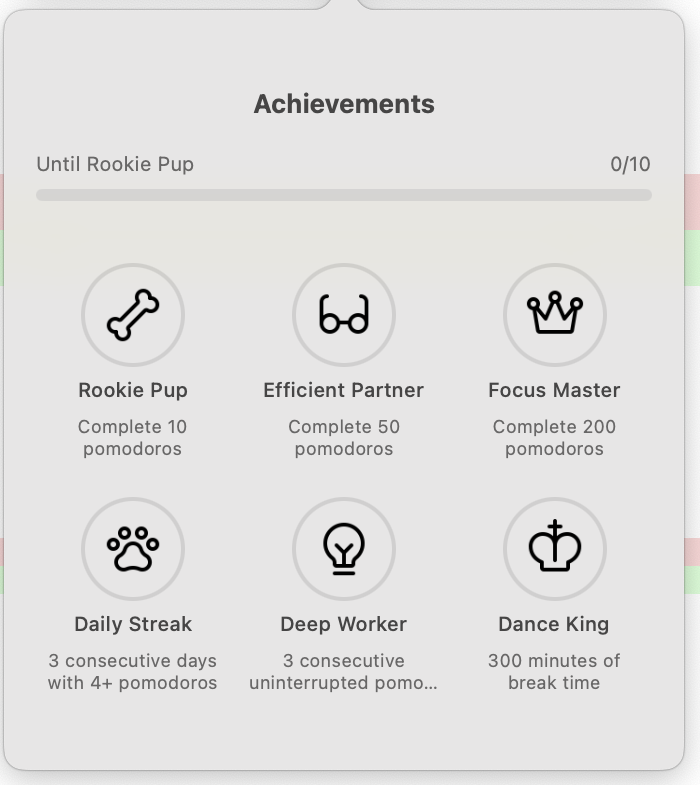
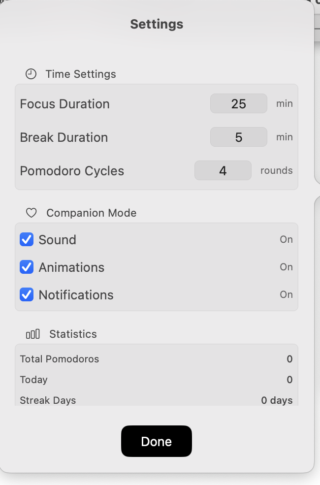

# 🍅🐶 PomodoroPup（番茄小狗）

> 一款常驻 macOS 菜单栏的番茄钟应用，搭配动态小狗伙伴与成就徽章。


PomodoroPup 安静地待在你的菜单栏里。开始专注，一只小狗就会陪你一起工作；进入休息，它便端起咖啡惬意放松。完成番茄钟后，你可以在成就墙解锁骨头、眼镜、皇冠等徽章，让专注多一点仪式感。这些目前是成就图标，应用尚未实现把已解锁物品穿戴到小狗身上。

**[English README →](README.md)**

---

## ⬇️ 下载安装

**[⬇️ 下载 PomodoroPup 1.0（.zip）](https://github.com/yvetteL19/PomodoroPup/releases/download/v1.0/PomodoroPup.1.0.zip)** —— 或浏览全部 [Releases](https://github.com/yvetteL19/PomodoroPup/releases)。

由于没有苹果开发者账号签名，首次打开 App 时可能会提示"无法验证开发者"或"文件已损坏"。

**解决方法：**

1. 下载并解压后，**不要**直接双击打开。
2. 对着 App 图标**点击鼠标右键**，选择 **"打开"**。
3. 在弹出的警告框中点击 **"打开"** 即可正常运行。

（或前往 **系统设置 → 隐私与安全性 → 仍要打开**。）

上方链接仍指向原有 1.0 发布包。下文的可靠性改进描述的是当前源码，本轮尚未重新发布安装包。使用当前源码请参见 [构建与运行](#-构建与运行)。

---

## 📸 应用截图

这些截图展示较早版本的界面；当前源码另有明确的暂停状态、计时恢复提示与数据错误提示。

| 准备专注 | 专注中 | 休息中 |
| :---: | :---: | :---: |
|  |  |  |

| 成就墙 | 设置 |
| :---: | :---: |
|  |  |

---

## ✨ 功能特性

- **常驻菜单栏**——状态图标 + 实时倒计时，抬眼即见，不占用桌面空间。
- **会动的小狗伙伴**——专注时小狗带有细微的呼吸动画；休息时切换为悠闲喝咖啡的小狗（动态 GIF）。
- **按批次运行**——工作与休息自动衔接，完成设定数量的有效专注后停止。再次开始会开启新批次，保留今日进度。
- **成就系统**——六个徽章覆盖里程碑、坚持、连续完成与休息。音效、动画遵循各自开关，视觉效果也遵循系统“减少动态效果”设置。
- **进度一目了然**——小圆点显示今日有效完成的番茄，跳过不计入；成就墙展示距离下一个里程碑的进度。
- **原生通知**——该休息、该继续、达成每日目标时，给你温柔的横幅提醒。
- **可配置**——专注/休息时长、目标数量，以及音效、动画、通知开关。目前同一个目标数量同时决定每日目标和批次长度。
- **双语支持**——简体中文与英文，随系统语言自动切换。
- **新手引导**——三步欢迎流程，帮你设定每日目标并申请通知权限。
- **暂停恢复**——运行期间保存当前计时；重启或睡眠后以暂停状态恢复，由你点击继续。离线时间不计为工作或休息。
- **保护本地数据**——统计与偏好使用版本化快照，旧数据迁移前保留原始备份。遇到无法读取或不支持的版本时停止计时并保留原数据。应用离线、沙盒运行。

---

## 🔄 工作原理

```
 准备 → 开始 → 专注 → 休息 → 专注 → …
                          └─ 完成设定数量的有效专注后 → 准备
 工作或休息 → 暂停 → 继续同一阶段
 重启 / 睡眠 → 恢复为暂停 → 手动继续
```

- 只有自然**完成**的专注阶段才增加累计番茄、完成当日的番茄数、连续专注数和当前批次计数。
- 专注结束后进入休息；休息结束后，若当前批次尚未达到目标（默认 4 个有效番茄），则自动进入下一次专注，否则停止。
- **跳过**只切换阶段，不计入完成数和批次进度；跳过工作会中断连续专注。暂停时跳过，下一阶段仍保持暂停。
- **重置**放弃未完成阶段，清空当前批次和连续专注数，保留已完成统计及成就。操作发生时若当前阶段已经到期，会先结算到期阶段。
- 在准备状态点击**开始**会开启新批次，今日完成数不会因重置或开启新批次而清空。
- 调整专注或休息时长对后续阶段生效；正在运行或暂停的阶段保留原来的时长和剩余时间。
- 休息时长只在休息计时运行时累计，暂停、睡眠和离线时间不累计。
- 每日统计按完成时刻所属日期记录，使用首次创建新存储或迁移旧数据时保存的时区。以后改变系统时区，不会重写原有每日统计。

当前存储是“按日完成数 + 当前计时快照”，尚未保存每一次专注的完整历史记录。迁移、恢复边界和待完成的手动验收见 [可靠性与数据保护说明](docs/reliability.md)。

---

## 🏆 成就一览

| 图标 | 名称 | 解锁条件 |
| :---: | :--- | :--- |
| 🦴 | **萌新小狗** | 累计完成 10 个番茄 |
| 👓 | **高效搭档** | 累计完成 50 个番茄 |
| 👑 | **专注大师** | 累计完成 200 个番茄 |
| 🐾 | **连续出勤** | 连续 3 天，每天至少 4 个番茄 |
| 💡 | **深度黑客** | 连续完成 3 个番茄，期间不跳过工作或重置 |
| ✨ | **舞蹈之王** | 累计休息时间达 300 分钟 |

新成就解锁时，在对应效果开启的情况下播放音效、闪烁菜单栏标签并抖动奖杯。加载已保存成就不会重复播放庆祝效果。

---

## 🛠 构建与运行

**环境要求：** macOS 15.5+，并将 Xcode 16.4+ 选为当前开发工具。

```bash
git clone https://github.com/yvetteL19/PomodoroPup.git
cd PomodoroPup
open PomodoroPup.xcodeproj
```

随后在 Xcode 中构建并运行（**⌘R**）。应用会出现在菜单栏，点击图标即可打开弹窗。

不启动应用即可运行模型与存储测试：

```bash
swift test
```

执行 Debug 与 Release 构建，不启用签名（用于本地验证，不等于可分发版本）：

```bash
xcodebuild -project PomodoroPup.xcodeproj -scheme PomodoroPup \
  -configuration Debug -destination 'generic/platform=macOS' \
  -derivedDataPath /tmp/PomodoroPup-Debug CODE_SIGNING_ALLOWED=NO build
xcodebuild -project PomodoroPup.xcodeproj -scheme PomodoroPup \
  -configuration Release -destination 'generic/platform=macOS' \
  -derivedDataPath /tmp/PomodoroPup-Release CODE_SIGNING_ALLOWED=NO build
```

测试使用隔离的 `UserDefaults` suite 和可注入时钟，不启动菜单栏应用，也不修改真实应用偏好。[macOS CI](.github/workflows/ci.yml) 执行同样的测试与构建。通过这些检查不能替代真实睡眠、系统通知和发布签名验证，详见 [待执行的手动检查](docs/reliability.md#manual-checks-not-yet-performed)。

---

## 🧱 架构设计

应用采用 **MVVM** 架构，使用 SwiftUI 的 `MenuBarExtra` 进行展示。

| 文件 | 职责 |
| :--- | :--- |
| `PomodoroPupApp.swift` | 应用入口；配置 `MenuBarExtra`、实时菜单栏标签（含成就闪烁）与新手引导窗口。 |
| `DogViewModel.swift` | 阶段切换、经过时间结算、每日与批次统计、成就、生命周期恢复，以及保存成功后的音效和通知。 |
| `TimerClock.swift` | 可注入时钟：实际日期用于日统计，单调运行时间用于倒计时。 |
| `StateStore.swift` | 版本化 JSON 快照、数据验证，以及带一次性备份的旧数据迁移。 |
| `ContentView.swift` | 主弹窗的小狗、倒计时、今日完成圆点、暂停/恢复/错误状态与控制按钮，以及成就墙和设置弹窗。 |
| `DogView.swift` | 会动的小狗：专注呼吸姿态，以及 GIF/静态休息姿态（通过 `NSViewRepresentable` 实现 GIF 播放）。 |
| `SettingsView.swift` | 时间设置、陪伴模式开关与统计信息。 |
| `OnboardingView.swift` | 首次启动的三页欢迎流程。 |
| `SoundManager.swift` | 基于 AVFoundation / 系统音效的播放。 |

**技术栈：** SwiftUI · Combine · AppKit（GIF 渲染与音效）· UserNotifications · AVFoundation。

---

## 🌐 本地化

界面文案位于 `en.lproj/Localizable.strings` 与 `zh-Hans.lproj/Localizable.strings`，通过 `NSLocalizedString` 解析，应用会随系统语言自动切换。

---

## 🔒 隐私说明

PomodoroPup 完全离线、沙盒运行。设置、成就、每日完成数和当前计时快照通过 `UserDefaults` 保存在本地。没有统计上报、账号体系或网络访问。迁移备份位于同一个本地偏好存储中，不等于云同步或独立的备份服务。

---

## 📁 项目结构

```
PomodoroPup/
├── PomodoroPup.xcodeproj/        # Xcode 工程
├── PomodoroPup/                  # 源代码
│   ├── PomodoroPupApp.swift
│   ├── DogViewModel.swift
│   ├── TimerClock.swift
│   ├── StateStore.swift
│   ├── ContentView.swift
│   ├── DogView.swift
│   ├── SettingsView.swift
│   ├── OnboardingView.swift
│   ├── SoundManager.swift
│   ├── Assets.xcassets/          # 小狗插画、成就图标
│   ├── en.lproj / zh-Hans.lproj  # 本地化资源
│   └── *.MP3                     # 音效文件
├── Tests/PomodoroPupCoreTests/  # 可控时钟下的模型与存储测试
├── Package.swift                # 供 SwiftPM 测试生产模型
├── .github/workflows/ci.yml      # macOS 测试与两种配置构建
├── docs/reliability.md           # 数据保护、恢复规则与手动验收
├── docs/screenshots/            # 较早版本的 README 截图
└── README.md
```

---

<p align="center">用 🍅 与 🐶 打造——专注一点点，奖励一点点。</p>
