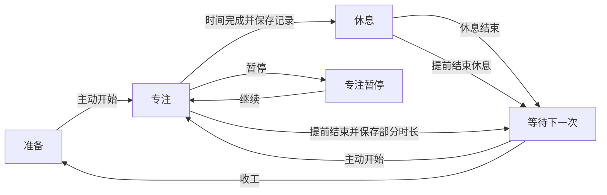

# PomodoroPup 产品评估与商业化重构方案

评估日期：2026 年 10 月 22 日。代码基线：`be6e4b7`。

本文记录重构前的评估，代码证据链接固定到当时版本。第一阶段已实施的行为与验证边界见 [可信度修复说明](reliability.md)。

**建议继续做这个产品，并把方向收紧为：陪独自使用 Mac 的人更容易开始工作、完成一段专注、安心休息的小狗伙伴。** 当前版本已经有清楚的外形和基本计时闭环，适合进入修复与用户验证阶段；数据可靠性、陪伴成长和付费理由尚不足以支撑直接商业发布。

下一版的顺序应当是：修复数据与计时 → 打磨第一次完整体验 → 兑现小狗成长 → 验证复用和付费。保留原生 SwiftUI、菜单栏入口、离线体验与现有插画，分阶段重构逻辑和体验。

本方案按“小团队制作可持续销售的独立 macOS 产品”制定。定位、价格和排期属于待验证的产品决策；代码事实与已复现问题另行标明。本轮仅新增评估文档，没有修改应用源码。

## 项目现状与产品判断

### 实际实现的产品

PomodoroPup 是一个 macOS 15.5 及以上的原生菜单栏番茄钟。用户从菜单栏展开约 320 pt 宽的面板，启动专注，小狗显示工作形象；完成后自动进入休息，小狗切换为喝咖啡的 GIF；休息结束自动进入下一轮，达到设定周期数后停止。支持暂停、继续、跳过、重置，自定义工作和休息时长，六个成就、基础累计统计、中英文和首次引导。

数据使用 UserDefaults，项目没有账号、云同步、服务端、遥测或支付实现。SwiftUI、Combine、AppKit、UserNotifications 与 AVFoundation 承担全部核心能力。业务集中在 524 行的 DogViewModel，工程没有测试 target。七个 Swift 文件合计 1,297 行，当前规模适合渐进拆分。

| 维度 | 当前判断 | 对产品决策的意义 |
| --- | --- | --- |
| 使用入口 | 菜单栏入口清楚，适合轻量工具 | 保留这个入口，减少唤起后的操作 |
| 视觉记忆 | 黑白小狗有辨识度，专注和休息姿态容易理解 | 继续投入角色的一致性与状态表达 |
| 基础交互 | 能完成计时流程，但目标、周期、暂停等概念混杂 | 需要重写行为规则，再调整界面 |
| 数据信任 | 重启覆盖数据、跨日统计、跳过达标存在确定缺陷 | 商业发布前的首要门槛 |
| 陪伴与成长 | 有状态动画和徽章，没有可使用的装扮、关系记忆或成长反馈 | 当前差异化停留在角色外观 |
| macOS 适配 | 原生技术路线合理，首次发现、退出、快捷键和辅助功能仍需补齐 | 决定它是否像一个成熟 Mac 应用 |
| 商业化 | 没有权益、购买、恢复购买与完整分发流程 | 先证明用户愿意持续用，再建设收费体系 |

### 值得保留的资产

小狗在工作和休息时呈现不同状态，这能帮助用户理解节奏，也具备传播画面。菜单栏、离线、无注册和少量设置让开始使用的成本较低。中英文本地化已经有基础。产品体量小，修复和迭代成本可控。

真正需要重新设计的是三个关系：用户行动如何影响小狗；小狗如何帮助用户开始下一次；用户为什么愿意为长期体验付费。

### 文档承诺需要与当前版本对齐

- README 介绍“解锁装扮”，但 [DogView.swift](https://github.com/yvetteL19/PomodoroPup/blob/be6e4b7ddddf977d3d8983c4950efe355e7c042e/PomodoroPup/DogView.swift#L9) 只按工作或休息选择素材，没有读取成就、选择或佩戴配饰。当前解锁结果体现在成就墙。
- CLAUDE.md 仍描述长休息、装扮叠加、跳跃、项圈调整与粒子效果；当前代码已简化，不能据此制定后续需求。Git 历史也明确记录过移除长休息的改动。
- 截图属于仓库内的历史截图。例如成就图显示 0/10 却展示全部成就图标，当前代码对未解锁项显示锁。截图适合评估视觉方向，不代表当前所有运行状态。

上线前同步更新代码说明、帮助文案、商店介绍和截图，让每一项对外承诺都能在产品内找到。

## 用户定位与核心价值

### 首批用户假设

优先服务独自用 Mac 写作、设计、编码或学习的人。他们已经知道自己要做什么，却容易拖延启动；工作进入状态后又容易忘记休息。他们愿意接受一点角色陪伴，但不希望管理另一个复杂系统。

首次研究需要验证这个假设，尤其区分“喜欢小狗图”和“会因为小狗更愿意开始或再次使用”。没有足够证据把产品宣传为治疗、缓解 ADHD 或其他健康问题的工具。

可以用一句话解释产品：**和你的小狗，一次完成一件事。**

用户要完成的任务是：“当我坐到电脑前迟迟不想开始时，帮我用很少的准备进入一小段工作，并在结束时知道自己做了什么。”对应三个实际收益：更容易开始、过程不被打扰、结束后有具体的完成感。

### 产品原则

1. **一次打开，只有一个最明显的下一步。** 开始、暂停、继续、开始下一次随状态变化，危险或低频动作退出主要视觉层级。
2. **小狗回应真实行动。** 完成、休息、回来都会得到合适反馈；暂停、离开、断签不会让宠物受罚。
3. **成长发生在专注之间。** 工作期间保持安静，装扮、回顾和购买安排在用户主动查看或自然结束的时刻。
4. **用户记录必须可信。** 区分计时记录、完成的专注段与用户实际产出；不用“计时器走完了”证明真实工作质量。

## 商业发布前的关键问题

P0 表示阻止商业发布；P1 表示下一次完整体验版本必须处理。以下严重程度按用户影响排序，不是纯代码复杂度排序。

| 优先级 | 已确认问题与证据 | 用户后果 | 修复后的验收条件 |
| --- | --- | --- | --- |
| P0 | 加载状态时，属性 didSet 调用全量 saveState，将尚未读出的值覆盖。[加载入口](https://github.com/yvetteL19/PomodoroPup/blob/be6e4b7ddddf977d3d8983c4950efe355e7c042e/PomodoroPup/DogViewModel.swift#L203)、[写入](https://github.com/yvetteL19/PomodoroPup/blob/be6e4b7ddddf977d3d8983c4950efe355e7c042e/PomodoroPup/DogViewModel.swift#L184) | 重启后累计记录、成就与偏好丢失；已在隔离数据中复现 | 已有记录、设置、成就在反复重启和升级迁移后保持一致；读取阶段不写存储 |
| P0 | 每次 tick 减 1 秒，没有基于时间点校正；启动时总回到 stopped，没有保存剩余时间。[计时](https://github.com/yvetteL19/PomodoroPup/blob/be6e4b7ddddf977d3d8983c4950efe355e7c042e/PomodoroPup/DogViewModel.swift#L342)、[初始化](https://github.com/yvetteL19/PomodoroPup/blob/be6e4b7ddddf977d3d8983c4950efe355e7c042e/PomodoroPup/DogViewModel.swift#L164) | 定时回调延迟会造成偏差，退出或异常重启无法恢复；休眠策略缺失 | 暂停、重启、休眠、唤醒与系统时间变化有明确且通过测试的处理 |
| P0 | 工作完成先递增今日数，再检查跨日并清零。[完成](https://github.com/yvetteL19/PomodoroPup/blob/be6e4b7ddddf977d3d8983c4950efe355e7c042e/PomodoroPup/DogViewModel.swift#L364)、[跨日](https://github.com/yvetteL19/PomodoroPup/blob/be6e4b7ddddf977d3d8983c4950efe355e7c042e/PomodoroPup/DogViewModel.swift#L258) | 新一天第一个完成记录会被清掉，也可能错误补足昨天目标；已复现 | 日期切换不丢记录；归属日和连续天数只从确定的记录规则计算 |
| P0 | 跳过仍增加 pomodorosInCycle，达标由该计数决定，通知却说完成了今日番茄数。[跳过计数](https://github.com/yvetteL19/PomodoroPup/blob/be6e4b7ddddf977d3d8983c4950efe355e7c042e/PomodoroPup/DogViewModel.swift#L358)、[达标](https://github.com/yvetteL19/PomodoroPup/blob/be6e4b7ddddf977d3d8983c4950efe355e7c042e/PomodoroPup/DogViewModel.swift#L398) | 可以实际完成 0 个却收到达标通知；已复现 | 今日目标只读取有效完成数；跳过仅结束阶段，不贡献完成数 |
| P0 | 暂停工作后点跳过，休息计时统计仍被启动，但主计时器保持暂停。[暂停](https://github.com/yvetteL19/PomodoroPup/blob/be6e4b7ddddf977d3d8983c4950efe355e7c042e/PomodoroPup/DogViewModel.swift#L323)、[休息统计](https://github.com/yvetteL19/PomodoroPup/blob/be6e4b7ddddf977d3d8983c4950efe355e7c042e/PomodoroPup/DogViewModel.swift#L390) | 界面时间不动，休息累计却增长；已复现 | 暂停时所有相关时长停止增长；只有一个可信时钟来源 |
| P1 | dailyGoal 同时表示每日目标和一批自动循环的长度，完成后再开始不重置周期 | 再开一批只完成一轮就停止；已复现 | 每日目标、周期进度、自动衔接设置分别建模；目标达成后仍可正常继续 |
| P1 | 暂停时 timerState 不变，文案仍显示专注中，小狗仍可能呼吸。[状态文案](https://github.com/yvetteL19/PomodoroPup/blob/be6e4b7ddddf977d3d8983c4950efe355e7c042e/PomodoroPup/ContentView.swift#L101)、[动画](https://github.com/yvetteL19/PomodoroPup/blob/be6e4b7ddddf977d3d8983c4950efe355e7c042e/PomodoroPup/DogView.swift#L29) | 无法一眼确认是否真的暂停 | 菜单栏、面板、动画和按钮一致表达暂停 |
| P1 | 通知开关未映射系统授权；拒绝后只打印日志；通知音无条件使用默认声。[权限](https://github.com/yvetteL19/PomodoroPup/blob/be6e4b7ddddf977d3d8983c4950efe355e7c042e/PomodoroPup/DogViewModel.swift#L488)、[通知](https://github.com/yvetteL19/PomodoroPup/blob/be6e4b7ddddf977d3d8983c4950efe355e7c042e/PomodoroPup/DogViewModel.swift#L501) | 显示“开启”却收不到，关闭音效仍可能听到系统通知声 | 展示真实授权状态；静音行为统一；提供系统设置入口和一次测试提醒 |
| P1 | 新手引导的显式触发在首次展开菜单栏面板时；应用没有自定义的可见退出入口。[入口](https://github.com/yvetteL19/PomodoroPup/blob/be6e4b7ddddf977d3d8983c4950efe355e7c042e/PomodoroPup/ContentView.swift#L87)、[App 场景](https://github.com/yvetteL19/PomodoroPup/blob/be6e4b7ddddf977d3d8983c4950efe355e7c042e/PomodoroPup/PomodoroPupApp.swift#L10) | 首次安装后的发现与操作缺少明确引导；实际首次窗口行为还需安装流程实测 | 干净安装后明确展示如何找到应用、开始和退出 |
| P1 | 成就关闭动画后仍会闪菜单栏、抖奖杯；主界面硬编码白底，成就描述 9 pt、两行裁切。[主界面](https://github.com/yvetteL19/PomodoroPup/blob/be6e4b7ddddf977d3d8983c4950efe355e7c042e/PomodoroPup/ContentView.swift#L27)、[成就](https://github.com/yvetteL19/PomodoroPup/blob/be6e4b7ddddf977d3d8983c4950efe355e7c042e/PomodoroPup/ContentView.swift#L194) | 动效偏好不被完整尊重，深色与阅读体验存在风险 | 深浅模式、减少动态效果、键盘和 VoiceOver 逐项验收 |

补充问题：休息通知写死“5 分钟”；修改暂停状态下的时长会直接重置剩余时间；60 次 tick 后停在 00:00，第 61 次才完成；连续三天达标的解锁检查滞后；休息成就只在下一次专注完成时检查。这些应随同一次状态与统计重构处理。

**数据修复应先保护现存数据。** 新版迁移先读取完整快照，再验证、转换、一次性提交；迁移前保留可恢复副本。已经被旧版本覆盖的记录，只能从实际存在的备份恢复，不能用推测数据补造历史。

## 重新设计完整使用过程

### 第一次打开

当前引导先介绍产品、设每日目标、请求通知，用户还没有体验核心价值。建议压缩为一个轻量欢迎界面：小狗、简短价值说明、10 / 25 / 45 分钟预设、一个“开始第一次专注”按钮。目标与小狗名字可以之后再设置。

点击开始前，在明确说明用途的上下文中提供通知授权，允许暂时跳过。拒绝授权也可以正常使用；设置页显示真实状态。引导结束时指示菜单栏位置，避免窗口关闭后“应用消失”的感觉。

时长只是初始候选预设。默认建议 25 分钟，同时为难以开始的人提供 10 分钟入口；不强迫用户先承诺每天 4 个番茄。

### 主面板的信息层级

建议保持约 320–360 pt 的紧凑面板，以实际英文长度和系统字号验证尺寸。纵向顺序为：

1. 顶部状态与次级菜单：准备、专注中、已暂停、休息中。
2. 小狗与最多一行的情境反馈。
3. 倒计时，以及可选的本次意图，例如“写完方案开头”。
4. 一个主按钮和至多一个常用次按钮。
5. “今天完成 2 次 · 计时 50 分钟”，再按需显示目标进度。
6. “伙伴”“记录”“设置”入口。

总累计数移入记录页。进度圆点可以作为补充，但必须有“今天 2/4 次”等文字，不能只靠点数传达目标。进行中的会话不能提前涂成已完成。

用户开始时可以直接按主按钮。任务意图完全可跳过，保留上次常用内容；本阶段只记录一次想做什么，不引入项目、优先级和复杂任务管理。

### 状态与动作规格

| 显示状态 | 主动作 | 次动作 | 需要明确的行为 |
| --- | --- | --- | --- |
| 准备专注 | 开始 25 分钟 | 更改时长 | 不必填写任务；未开始不产生会话记录 |
| 专注中 | 暂停 | 更多 | 提前结束放入更多菜单；保留已计时时长，不记为完整番茄 |
| 专注已暂停 | 继续专注 | 结束本次 | 所有时间停止增长；暂停不会让小狗受罚 |
| 休息中 | 暂停休息 | 提前结束休息 | 提前结束进入等待，由用户决定何时再次工作 |
| 休息已暂停 | 继续休息 | 结束休息 | 动画和文案同步暂停，不累计休息时间 |
| 休息结束等待 | 开始下一次 | 今天先到这里 | 默认不自动开始用户不在场的下一轮工作 |
| 今日目标达成 | 再来一次 | 今天收工 | 这是鼓励反馈，不是强制停止或禁用开始 |

“今日目标达成”在数据模型中是一个标记，可以与休息状态同时存在；不要把它做成排斥所有计时状态的另一套状态机。休息期间保留休息状态的按钮，达标仅显示为简短反馈；休息结束后才显示“再来一次”和“今天收工”。

默认完成工作后进入休息，休息结束等待确认。自动开始下一轮放入可选设置，并解释其行为。长休息可作为后续高级预设，在完成若干次有效工作后触发；跳过不能推进长休息周期。每日目标只负责日内反馈。

### 中断与错误恢复

“结束本次”使用轻量结果说明：已记录 12 分钟，本次未记为完成。提供短时间内可撤销的恢复操作，避免每次都打断用户确认。撤销时恢复原会话的暂停状态，撤回刚生成的部分结算，继续时沿用同一会话 ID；撤销等待时间不算专注，记录与成长不能重复累计。清空所有历史等不可恢复操作才需要明确确认。

修改默认时长通常从下一次开始生效；如果允许修改当前会话，需要明确操作，例如“本次增加 5 分钟”。不能因为编辑设置就悄悄抹掉已走过的时间。

睡眠默认暂停，唤醒后让用户选择继续；退出或异常中断后恢复到可解释的暂停状态。自动模式也不能在电脑休眠期间不断补出完成记录。锁屏与睡眠应区分：用户可能离开屏幕阅读，不能把无键盘输入直接判断为没有专注。

### 结束与回顾

完成时给一个很短的具体反馈，例如“这一段完成了。我们休息 5 分钟。”如有任务意图，可在记录中看到“写完方案开头 · 25 分钟”。所有数量与时长由会话数据生成。

记录页默认展示今天：完成的专注段、实际计时时长、部分完成记录和休息。周视图帮助用户发现自己更常在哪些时段启动，而不是只显示几个终身累计数字。措辞始终使用“记录的专注时间”，不暗示应用知道用户真正完成了多少工作。

## 让小狗形成可持续的陪伴体验

### 当前成长反馈的缺口

按默认 25 分钟计算，10 / 50 / 200 个番茄分别需要约 4 小时 10 分钟、20 小时 50 分钟、83 小时 20 分钟的工作计时，不含休息。前三个里程碑跨度大，用户首次完整体验中看不到这条成长线。另一个“连续 3 次”成就更早，但仍需要较长使用才能出现。解锁之后也没有可操作的佩戴结果。

时长可设为 1–120 分钟，而所有完成会话对数量成就贡献相同。因此单用番茄数量也难以表达投入。需要区分“完成一次的反馈”和“按累计计时成长的里程碑”。

### 最小可交付的关系闭环

**用户完成一段 → 小狗出现可见变化 → 用户能选择或使用变化 → 下次打开保留它。**

第一版只做一只狗、少量可佩戴物品和一个简单场景。建议第一段完成后就获得一件小配饰或共同回忆；首次奖励需要在真实时长的体验中出现，不通过虚构完成来发放。后续成长依据累计有效计时时长与活跃天数，保持规则透明。

伙伴页提供名字、当前装扮、已获得物品、下一项可见奖励。点击物品能预览、佩戴和卸下，同类部位互斥，工作和休息姿态都适配。不要把所有解锁物品强行叠到狗身上。

每天可以有一句基于真实记录的简短反馈，例如“昨天我们完成了两段，今天从一小段开始。”这可以用本地规则完成，先避免引入开放式聊天、云推理、延迟和持续成本。

### 成就与关系分开

成就描述用户完成了什么；装扮决定小狗如何呈现；关系记录共同经历。三个概念可以互相连接，但需要在界面上分别解释。

优先奖励开始、完成、适量休息和间隔后重新回来。将严格断签改为更宽容的“本周专注 3 天”等反馈；长期累计成就保留。避免用饥饿、死亡、哭泣或付费补签制造压力。

“累计休息 300 分钟”可以保留为趣味成就，但它不能单独证明健康休息，也不该鼓励用户挂机。养成内容的价值需要通过第二周是否继续使用来验证。

### 陪伴的可见性

当前小狗主要出现在展开面板里；用户工作时关闭面板后只看到菜单栏图标。可以先测试一个可选的小型悬浮伙伴窗口：狗加状态即可，允许缩小、隐藏、移动，默认关闭。先确认它帮助用户启动与回来，再扩大投入。

不需要一开始做完整桌宠系统、复杂房间编辑器、宠物经济和持续喂食机制。它们的内容成本、动效成本和打扰风险都需要真实复用来支撑。

## 信息架构与视觉方向

菜单栏面板负责“此刻做什么”；伙伴页负责名字、装扮与成长；记录页负责回看；设置使用独立的原生窗口，容纳时长预设、声音、通知、启动方式、快捷键、外观和数据管理。较复杂内容不继续堆叠在菜单栏的多层 popover 中。

| 区域 | 调整方向 | 验收要点 |
| --- | --- | --- |
| 角色 | 保留黑白线稿，统一眼神、姿态、线宽和配饰锚点 | 工作、暂停、休息、完成均可辨识；小尺寸仍清楚 |
| 颜色 | 使用语义化背景、文字和边框；可增加一种低饱和强调色 | 系统深浅模式都清楚，状态不只靠颜色表达 |
| 字体 | 保留等宽倒计时，减少次级信息竞争；说明文字建议至少 12–13 pt 后实测 | 成就条件不再压成 9 pt 和两行截断；中英文无关键裁切 |
| 按钮 | 各状态一个主按钮；暂停与结束有明确区别 | 用户无需试错就能解释下一次点击的结果 |
| 动效 | 专注期间微弱或静止，完成时短反馈；同一事件统一调度 | 关闭动画和系统减少动态效果均有效，面板隐藏后停止无用绘制 |
| 通知 | 一次阶段变化只给必要反馈；前台避免音效、横幅和动画同时堆叠 | 关闭声音后不响；权限状态准确；文案对应实际时长 |
| 键盘 | 统一开始/暂停快捷键、Tab 焦点、Esc、设置与退出入口 | 鼠标不可用时核心流程仍可完成；快捷键冲突可解释 |
| 辅助功能 | 图标按钮提供名称，进度提供文字，状态变化可读 | VoiceOver 可以识别当前阶段、暂停、时间与下一步 |

苹果的通知指南强调简洁、有价值的信息，并建议应用在前台时采用不打扰的反馈；减少动态效果也应覆盖重复和周边运动。这些原则与专注工具的任务一致。[通知指南](https://developer.apple.com/design/human-interface-guidelines/notifications/) · [辅助功能指南](https://developer.apple.com/design/human-interface-guidelines/accessibility)

## 工程重构边界

### 逐步拆分核心逻辑

保留 SwiftUI 与原生技术栈，不需要为这个规模引入服务端或更换框架。先拆开会影响正确性的职责：

| 模块 | 责任 |
| --- | --- |
| SessionEngine | 状态转换、开始、暂停、恢复、结束与阶段完成；不直接播放声音或写 UserDefaults |
| Clock 与生命周期适配 | 当前时间、活动时长、休眠唤醒、重启和时间变化；可注入假时钟测试 |
| SessionRepository | 保存会话、原子提交、迁移和恢复 |
| Statistics | 从记录计算今日、周视图、有效完成与活跃天数 |
| CompanionProgress | 根据已提交事件解锁成长、保存装扮与共同记录 |
| NotificationService | 授权状态、计划与取消提醒、通知动作、声音规则 |
| SettingsStore | 用户偏好、时长预设与版本化加载 |
| PurchaseService | 在收费阶段增加购买、权益、恢复和离线已购校验 |

ViewModel 只向界面提供状态和接收操作。阶段完成先可靠提交一次会话，再更新统计与宠物反馈。事件带唯一 ID，避免恢复时重复发奖或重复累计。

### 计时与数据模型

计时器回调只负责刷新显示，不负责定义过去了多少时间。运行中根据时钟和阶段截止点推导剩余时间，暂停时冻结有效剩余时间；时间源需覆盖系统时钟修改、休眠与重启策略，并用可控时钟验证。

每段记录至少包含：ID、阶段类型、开始时间、结束时间、当次计划时长快照、有效计时秒数、暂停时长、结果（完成、提前结束、跳过或中断）、可选意图和时间归属信息。有效计时扣除暂停及按规则处理的睡眠，不代表对人的注意力进行了监测。

一次跨午夜的完整会话，完成次数建议归到结束当天；每日计时分钟按实际跨日区间分配。时区策略需要固定并明确，避免用户旅行或修改时区后历史不断漂移。

当前累计数无法重建过去每天的详细会话。迁移时保留“历史累计”，新版本开始保存逐次记录，界面明确历史明细从何时开始。设置可继续用 UserDefaults；记录需要可迁移的结构化存储，当前平台范围内可优先评估 SwiftData。

### 测试与发布门槛

计时和存储属于需要自动化测试的核心。至少覆盖：

- 全部合法状态转换、重复点击、暂停后跳过、设置修改与结束撤销。
- 时间回调延迟、零秒边界、睡眠/唤醒、强制退出和重启恢复。
- 午夜、跨时区、连续天数、目标变化、跨日会话和跳过不计完成。
- 数据快照读取、旧版本迁移、迁移失败恢复、成就只解锁一次。
- 通知未请求、已同意、被拒绝、系统关闭、应用静音和前台状态。
- 中英文、深浅外观、键盘导航、VoiceOver、减少动态效果。
- 首次安装、重新打开、设置退出、登录启动、多显示器与菜单栏拥挤。

性能需要实测：关闭面板与展开面板的 CPU、内存、动画资源和一段持续使用的能耗。当前审查没有性能测量，不能宣称已有性能问题或已达到轻量标准。

macOS 15.5 的最低版本会限制可安装人群，但不应仅改配置数字。先访谈目标用户的系统版本，盘点 API 后决定是否覆盖更早版本，并建立对应测试矩阵。

## 竞争定位与收费方案

### 最有价值的三个参照

以下价格是 2026 年 10 月 22 日查看官方页面时的公开值，不同商店地区可能不同。

| 参照 | 官方可确认内容 | 对 PomodoroPup 的决策启示 |
| --- | --- | --- |
| Flow | 免费提供计时、休息提醒和统计等；美国商店 Pro 月付 $2.99、年付 $17.99、终身 $39.99。[官网](https://www.flow.app/pricing) · [商店](https://apps.apple.com/us/app/flow-focus-pomodoro-timer/id1423210932?platform=mac) | 基础计时已存在成熟替代，需要用完整陪伴体验建立选择理由 |
| Session | 将专注意图、减少干扰和回顾连接起来；Pro $4.99/月或 $39.99/年。[产品](https://www.stayinsession.com/) · [价格](https://stayinsession.com/pricing) | 借鉴一次任务的闭环；现阶段不扩张到复杂屏蔽与工作流集成 |
| Finch | 自我照顾行为带动宠物冒险与发现；核心免费、Plus 增加内容与定制。它不是 Mac 番茄钟直接竞品。[官方介绍](https://finchcare.com/about-finch) | 借鉴行动引起可见关系变化，而不是简单增加徽章数量 |

这些产品证明存在不同的功能与收费设计，不直接证明 PomodoroPup 会有同样的需求、留存或付费率。

### 首个商业版本

建议验证“免费完整核心 + 一次性 Pro 解锁”。基础版本包括可靠计时、暂停恢复、通知、一个角色、至少一条有意义的成长路径、基础历史和用户数据导出。Pro 可以提供更多角色与装扮、场景、多个自定义专注预设、更深入的回顾和经过验证的小型伙伴窗口。

核心可靠性、恢复购买和取回自己数据都不应成为付费障碍。现有免费版本已经提供的能力，需要谨慎处理，避免升级后突然收回。

首轮可以测试中国区 ¥38 / ¥68 / ¥98，或国际 $9.99 / $14.99 / $19.99 的一次性价格；这些是实验价位，不是已经验证的定价结论。先展示具体权益与可用效果，再记录选择。产品可以交付后用真实购买、退款和后续使用验证；未开放购买的页面必须清楚标注意向登记。

不在第一次打开时展示支付墙。可以在用户主动查看额外装扮或多次体验价值后呈现升级页，说明包括什么、是否一次性和如何恢复购买。已解锁的免费奖励继续可用，不在专注期间推销。

订阅应等到持续内容或持续服务被实际交付、用户也愿意持续使用时再验证。Apple 对自动续订要求持续价值；有维护成本本身不能证明订阅对用户划算。[Apple 订阅规则](https://developer.apple.com/app-store/review/guidelines/)

### 分发与交付

当前 README 明确提示下载包没有开发者证书签名，需要用户绕过首次打开阻碍。商业版必须改善安装信任。首版建议优先评估 Mac App Store 免费下载加非消耗型 Pro 内购；商店外下载则准备 Developer ID 签名、公证、Hardened Runtime 和完整更新流程。两种渠道的成本分别评估，初期先完成一种。

Apple 将非消耗型内购定义为一次购买且不会过期或消耗的产品，适合永久功能解锁。购买处理中、取消、失败、退款后权益、恢复购买、离线使用和换机都需要有明确体验。[内购类型](https://developer.apple.com/help/app-store-connect/reference/in-app-purchases-and-subscriptions/in-app-purchase-types/) · [分发准备](https://developer.apple.com/documentation/xcode/preparing-your-app-for-distribution) · [macOS 公证](https://developer.apple.com/documentation/security/notarizing-macos-software-before-distribution)

发布资料同时准备：准确截图、简短演示、隐私说明、版本说明、帮助和反馈入口、清楚的商用素材来源。仓库未提供完整素材授权清单，需要核对插画、GIF、图标和音频的使用依据；这不等于已经发现侵权。

买断收入依赖持续新增用户和后续产品价值。评估收入时同时计算渠道费、退款、支持时间、设计内容成本和维护成本，再决定是否扩大获客投入。

## 验证方案与成功标准

### 第一轮观察真实使用

招募 8–12 位目标用户，包含正在使用番茄钟的人和曾经弃用的人。让他们从首次打开开始，找到应用、启动真实任务、暂停继续、结束、休息和再次开始。记录具体卡点，优先询问过去的行为和本次体验，不把愿望清单直接变成开发任务。

可用的内部体验目标：不经解释能找到入口；一分钟内开始第一段；用户能说清暂停、结束和目标进度；完成后知道下一步。这些是本项目拟定的验收目标，不是行业平均水平。

### 第二轮验证是否愿意回来

完成 P0 后，邀请 20–30 人使用 14 天。观察小狗是否带来第二周复用，并记录用户是否主动隐藏动画、关闭通知、放弃或卸载。可以安排顺序平衡的交叉体验，比较相同计时能力下的基础角色版与成长版；样本只用于找方向，不声称统计显著。

建议优先看以下指标：

| 指标 | 定义与用途 |
| --- | --- |
| 首次开始率 | 已完成安装并打开应用的人中，开始第一段的人数 |
| 首次完成率 | 已开始第一段的人中，有一段正常完成记录的人数；同时观察时长分布 |
| 第二周复用 | 完成第一次体验的人中，第 8–14 天仍有有效记录的人数 |
| 每周使用天数 | 有有效会话的天数，避免将长时间挂机视为更高价值 |
| 自报有帮助 | 研究回访中用户是否能描述产品帮助了什么实际任务 |
| 干扰信号 | 通知、声音、动画和悬浮窗的关闭原因，以及暂停和提前结束原因 |
| 付费结果 | 见到具体权益的人中真实购买、退款和购买后复用的情况 |

方向性的核心指标可以是“每周完成至少一段有帮助专注的活跃用户数”，其中“有帮助”需通过自愿反馈抽样确认，不能从计时器自动推定。小样本阶段同时报告分子和分母，不用漂亮百分比掩盖样本不足。

保持离线定位时，研究数据通过用户主动提交的本地导出和访谈收集。未来若加入遥测，需要更新隐私承诺并取得适当同意；任务文字和私人内容不进入默认统计。

### 根据结果收缩或扩大

如果用户觉得可爱却不再次使用，优先调整开始、结束和关系反馈，暂停扩大皮肤库。如果成长版对复用没有明显帮助，把产品保持为精致小工具，减少养成维护。如果用户持续使用但不愿付费，测试权益组合和价格，不通过削弱免费计时强迫转化。

获客素材优先展示一个完整的短过程：开始工作、小狗安静陪伴、完成后变化、自然休息。先在能接触到目标用户的 Mac 工作流、写作、设计或独立开发社区招募研究用户；实际发布由产品负责人决定，不在验证前承诺增长规模。

## 实施路线与交付标准

以下按一位熟悉 macOS 的工程师，加兼职产品设计和插画支持估算。各阶段按验收结果推进；Apple 审核、素材生产和招募时间另计。

| 阶段 | 参考时间 | 范围与交付物 | 进入下一阶段的条件 |
| --- | --- | --- | --- |
| 修复可信度 | 3–5 个工作日起 | 修复加载覆盖、跨日、跳过和暂停统计；保护旧数据；补关键回归测试；同步文档 | 核心缺陷无法复现，重启和迁移保留数据 |
| 完整体验版本 | 1–2 周 | 新状态规则、默认等待下一次、简化引导、真实通知权限、语义化颜色、退出与键盘入口 | 真实用户能独立完成主要路径，边界测试通过 |
| 陪伴验证版本 | 2–3 周 | 第一段奖励、一个可佩戴装扮体系、共同记录、基础历史；开展两周试用 | 有证据说明用户理解并在意成长体验；修复明显干扰 |
| 首个收费版本 | 1–2 周起 | 明确 Pro 权益、购买恢复、选定分发渠道、商店材料与支持入口 | 购买与恢复闭环通过，安装可信，付费价值可展示 |

这是一条约 6–8 周起步的商业 MVP 路线，不是对完整养成系统的交付承诺。若资源只有个人业余时间，应缩减角色和场景数量，保持可靠性与核心流程范围。

首版暂缓完整待办系统、社交排名、多平台同步、开放式 AI 聊天、复杂宠物商城和团队管理。这些功能可以在明确用户需求之后独立评估，不能替代当前核心体验的完成。

## 本轮验证记录

评估覆盖两个 README、CLAUDE.md、全部七个 Swift 文件、两份本地化、Xcode 工程配置、entitlements、素材目录及五张截图，并参考近期 Git 历史。当前 Debug 配置使用 Xcode 16.4 进行 macOS 无签名构建，结果为 `BUILD SUCCEEDED`。无签名 Debug 构建不代表通过商店审核或完成真实安装验收。

为保护真实用户数据，没有启动正式应用或读取其偏好。逻辑验证使用原 DogViewModel 的临时副本，将 UserDefaults 替换成随机隔离 suite，声音置为空实现，放开私有方法供调用；通知在相关用例中关闭。该验证确认了业务逻辑缺陷，不等同于完整 GUI 或睡眠实测。

| 隔离用例 | 观察结果 |
| --- | --- |
| 预置累计 42、今日 3、目标 8、时长 3000 秒、静音与骨头成就，再初始化 | 变为累计 0、今日 0、目标 4、时长 1500 秒、声音开启、成就空；存储也被覆盖 |
| 昨天已有 3 次，跨日后完成第一次 | 今日计数为 0，连续天数被错误加 1 |
| 目标 2，全部通过跳过推进 | 实际完成 0，仍进入周期目标完成分支 |
| 已达到周期目标后再次开始 | 一轮后再次停止，没有新的完整批次 |
| 暂停工作后跳过，等待约 2 秒 | 主倒计时不动且显示未运行，休息累计仍增加 |
| 60 秒工作阶段调用 60 次 tick | 留在工作状态的 00:00，第 61 次才切换 |
| 第三天完成第 4 次 | 连续天数仍为 2，三天成就未解锁 |

后续仍需验证的范围包括：真实首次安装与窗口呈现、各类系统通知状态、深色和辅助功能完整路径、睡眠唤醒、多显示器、资源消耗、购买恢复与发布渠道。方案中相应项目均保留为验收项。
